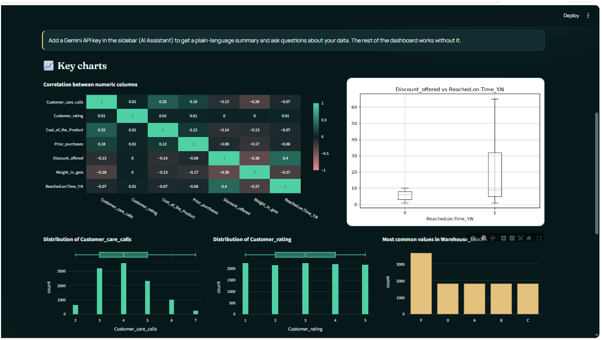
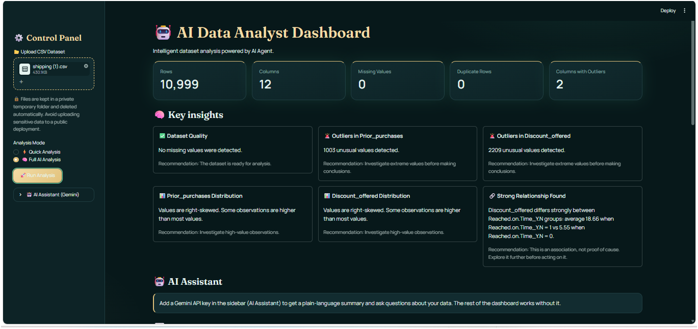
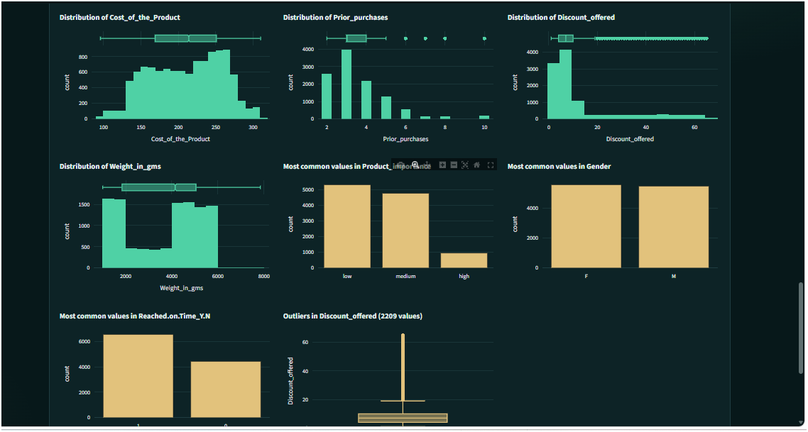

# 🤖 AI Data Analyst Agent

Upload a CSV and get a cleaned dataset, statistical insights, interactive charts and a PDF report in one click. An optional Gemini-powered assistant explains the results in plain language and answers questions about your data.

<!-- Add your screenshots to docs/screenshots/ and keep these lines -->


| Key insights + AI assistant | Interactive charts |
|---|---|
|  |  |

---

## ✨ What it does

- **Cleans the data:** removes duplicate rows and fills missing values (mean for numeric columns, `Unknown` for text). Missing values are counted *before* cleaning, so the report never hides them.
- **Understands the dataset:** detects column types, ID columns, binary columns and the most likely **target column** with a confidence level.
- **Finds outliers** with the IQR method and describes each numeric distribution (skewness).
- **Discovers relationships** between columns using appropriate statistics (see below), and reports their **direction**, not just their strength.
- **Visualizes everything** in a single-page Streamlit dashboard with interactive Plotly charts.
- **Exports a PDF report** (ReportLab).
- **AI assistant (optional):** a plain-language summary and a chat about your data, powered by Google Gemini.

## 🧠 How it works

```text
CSV upload
   │
   ▼
Planner ──► Executor ──► load → clean → profile → relationships
                         → outliers → distributions → insights
                         → charts → PDF report
   │
   ▼
Dashboard (Streamlit)  ──►  Optional: Gemini explains results / answers questions
```

The planner and executor are **rule-based** and deterministic: the same data always produces the same numbers, and no statistic is ever generated by a language model. The LLM layer only *explains* results that were already computed.

### Statistical methods

| Situation | Method | Reported when |
|---|---|---|
| Numeric feature vs. target | Cohen's d | effect size ≥ 0.3 |
| Categorical vs. categorical | Cramér's V with chi-square test | p < 0.05 and V ≥ 0.2 |
| Numeric vs. numeric | Pearson / Spearman (the stronger one) | \|r\| ≥ 0.5 |
| Outliers | IQR (1.5 × IQR rule) | per numeric column |
| Distribution shape | Skewness | \|skew\| > 0.5 |

Insights describe **associations and their direction**, and state clearly that association is not proof of cause.

## 🖥️ Dashboard

- **Quick Analysis:** instant overview and data-quality checks.
- **Full AI Analysis:** KPIs, key insights, correlation heatmap, distributions, category counts, missing-value chart, outlier boxplots, and a downloadable PDF report.
- Results persist while you interact with the page (they are kept in the session).
- Each browser session works in its own **private temporary folder**, so simultaneous users never mix files. Old folders are deleted automatically after a few hours.

## 🔐 AI assistant and privacy

The assistant is optional: without an API key the whole dashboard still works.

- Only a **statistical summary** (column statistics, relationships, outliers) is sent to Gemini. **No raw rows** are sent.
- The model is instructed to use only numbers from the summary and to answer "not available" when the summary does not contain the answer.
- Your key is never written to disk by the app. Free-tier terms of the Gemini API may allow your data to be used to improve Google products, so **do not use sensitive data** with a free key.

## ⚙️ Installation

```bash
git clone https://github.com/falcon-git2004/AI-Data-Analyst-Agent.git
cd AI-Data-Analyst-Agent

python -m venv venv
venv\Scripts\activate          # Windows
# source venv/bin/activate     # macOS / Linux

pip install -r requirements.txt
```

## ▶️ Run

```bash
streamlit run streamlit_app.py     # web dashboard
python app.py                      # command line, uses data/sample.csv
```

### Enable the Gemini assistant (optional)

Get a key from [Google AI Studio](https://aistudio.google.com/), then use **one** of these:

1. Paste it in the sidebar: **AI Assistant (Gemini)** → *Gemini API key* (kept in memory only).
2. Set an environment variable (PowerShell): `$env:GEMINI_API_KEY="your-key"`
3. Create `.streamlit/secrets.toml` (already git-ignored):
   ```toml
   GEMINI_API_KEY = "your-key"
   ```

The default model is `gemini-2.5-flash`. Change it in the sidebar or with the `GEMINI_MODEL` environment variable.

> ⚠️ Never commit your API key. Treat it like a password.

## 📂 Project structure

```text
AI-Data-Analyst-Agent
├── agent
│   ├── planner.py            # builds the execution plan
│   └── executor.py           # runs each step of the plan
├── tools
│   ├── data_loader.py        # CSV loading
│   ├── data_cleaner.py       # duplicates + missing values
│   ├── profiler.py           # column types, IDs, target detection
│   ├── relationship_engine.py# Cohen's d, Cramér's V, Pearson/Spearman
│   ├── outlier_detector.py   # IQR outliers
│   ├── distribution_analyzer.py
│   ├── insight_generator.py  # human-readable insights
│   ├── visualization*.py     # relationship charts (PNG)
│   ├── visual_explorer.py    # interactive Plotly charts
│   ├── report_generator.py   # PDF report
│   ├── quick_analyzer.py     # fast overview mode
│   └── llm_assistant.py      # Gemini summary + chat
├── .streamlit/config.toml    # theme + upload limit
├── streamlit_app.py          # dashboard
├── app.py                    # command-line entry point
└── requirements.txt
```

## ⚠️ Limitations

- The "agent" is a rule-based pipeline, not an autonomous LLM agent. The LLM layer explains results; it does not choose or run the analysis.
- Missing values are filled with the mean / `Unknown`, which can distort results when many values are missing. Check the Data Quality chart.
- Relationship detection reports associations only; it does not test causality or correct for multiple comparisons.
- The assistant answers from a summary, so questions that need row-level detail may be answered with "not available".
- Designed for CSV files up to 50 MB (configurable in `.streamlit/config.toml`).

## 🔮 Roadmap

- Filters in the sidebar that update all charts
- Automated tests with assertions (pytest)
- LLM-assisted planning and safe, sandboxed query execution
- Excel and Parquet support
- Public demo deployment

## 🛠️ Built with

Python · Pandas · NumPy · SciPy · Matplotlib · Seaborn · Plotly · ReportLab · Streamlit · Google Gemini API